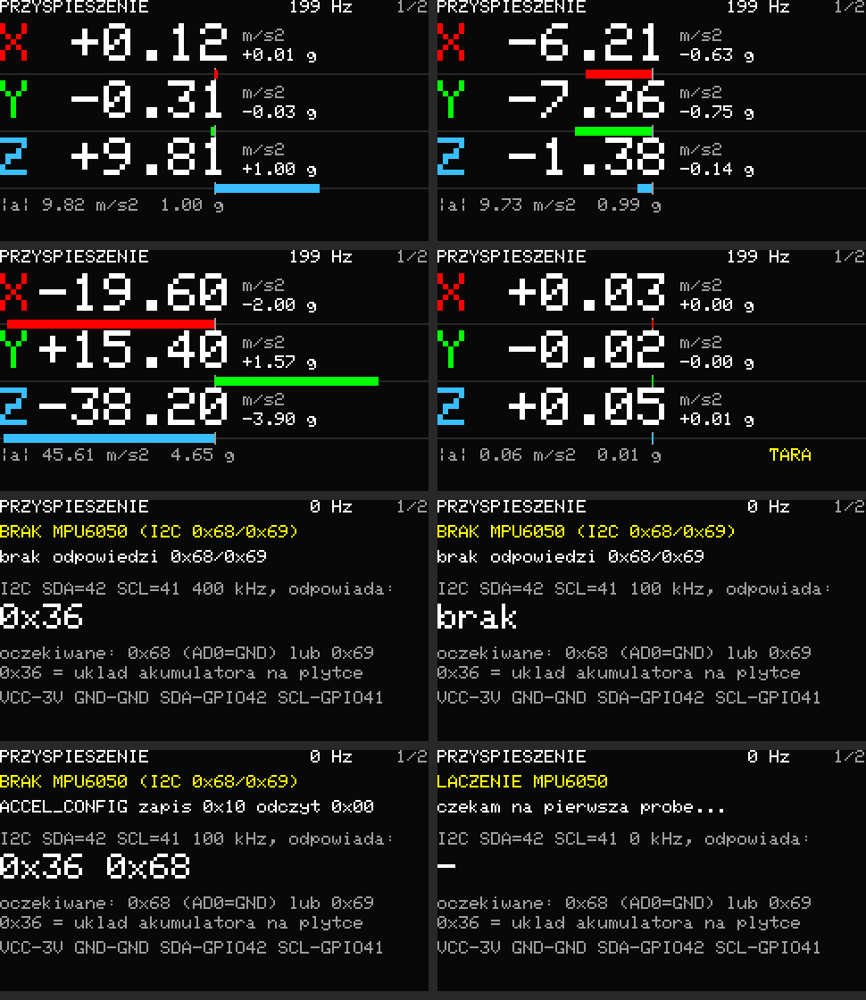

# Przenośny monitor drgań — Feather ESP32-S3 TFT + MPU6050

Pierwsza wersja do obserwacji przyspieszeń ramienia robota podczas ruchu.
Projekt PlatformIO znajduje się w tym katalogu. Płytka: Adafruit **5483**
ESP32-S3 TFT Feather, nie wersja Reverse TFT. Akcelerometr: MPU6050 (moduł
GY-521) przez I2C.

> **Stan obecny:** ekrany 1/2 — przyspieszenie XYZ, 2/2 — akumulator.
> Pozostałe funkcje są wyłączone flagami w `src/main.cpp`, a ich kod jest
> zachowany: ekrany analizy (przebieg czasowy, FFT, licznik ruchów —
> `imuEnabled`) oraz nawigacja po Wi-Fi (`ipsEnabled`; w praktyce działała
> słabo). Wyłączony moduł nie trafia do firmware. Bluetooth został usunięty.

## Połączenia

Czujnik pracuje na magistrali I2C płytki (400 kHz), tej samej co układ
pomiaru akumulatora (adres 0x36 — bez konfliktu z MPU6050 pod 0x68/0x69).
Ta magistrala jest też wyprowadzona na złączu STEMMA QT.

| MPU6050 (GY-521) | Feather |
|---|---|
| VCC | 3V (3,3 V) |
| GND | GND |
| SDA | SDA / GPIO42 |
| SCL | SCL / GPIO41 |
| INT | **A5 / GPIO8** |
| AD0 | GND albo niepodłączony → adres 0x68; 3V → 0x69 |
| XDA, XCL | niepodłączone |

- Firmware sam wybiera 0x68 lub 0x69.
- INT (aktywny stan wysoki, zatrzask do odczytu) zgłasza każdą nową próbkę;
  odczyt jest wtedy wyzwalany przerwaniem, a czas próbki to chwila
  przerwania — bez duplikatów i pominięć. Gdy INT nie jest podłączony,
  po ok. 100 ms firmware przechodzi na odpytywanie co 5 ms (komunikat na
  porcie szeregowym); pomiar działa, ale z mniej dokładnym czasem próbek.
- Konfiguracja: zakres ±8 g (4096 LSB/g), filtr dolnoprzepustowy 94 Hz,
  próbkowanie 200 Hz; żyroskop wyłączony.
- Moduły GY-521 mają własne rezystory podciągające I2C; Feather ma swoje.
  Krótkie przewody i wspólna masa.
- Gdy czujnik nie został wykryty, ekran przyspieszenia zamienia się w
  panel diagnostyczny: **powód** (brak odpowiedzi na adresie, odrzucony
  zapis, `WHO_AM_I` równe 0x00/0xFF, niezgodny odczyt konfiguracji),
  **użyte piny i prędkość I2C** oraz **lista adresów, które odpowiedziały**
  na magistrali. Układ akumulatora na płytce to 0x36: jeśli on jest na
  liście, a 0x68/0x69 nie, magistrala działa i błąd jest w podłączeniu
  MPU6050 (VCC, GND, SDA, SCL); jeśli lista jest pusta, sprawdź pierwsze
  piny SDA/SCL i zasilanie. Próby co 2 s na przemian 400 kHz i 100 kHz
  (długie przewody czasem działają tylko wolno); to samo wypisuje port
  szeregowy.

## Ekran i obsługa

Ekrany przełączane krótkim naciśnięciem BOOT (numer w prawym górnym rogu):
1 — przyspieszenie XYZ, 2 — akumulator. Z flagą `imuEnabled = true`
dochodzą ekrany analizy (opis niżej), wstawiane po ekranie 1.



*Podgląd wyrenderowany na komputerze tym samym kodem co na urządzeniu (skala 2×).*

### 1. Przyspieszenie XYZ

- Trzy wiersze: X czerwony, Y zielony, Z niebieski; wartość w m/s² i w g
  oraz pasek od środka (zero) w skali ±20 m/s²; na dole moduł |a|.
- Odczyt jest lekko wygładzony (ok. 0,15 s), żeby cyfry dało się czytać;
  nagłówek podaje faktyczną liczbę próbek na sekundę (ok. 200 Hz).
- Czujnik w spoczynku mierzy reakcję podłoża, więc położony płasko pokazuje
  Z ≈ +9,81 m/s² (1 g), a X i Y bliskie zeru. Osie są takie, jak na
  nadruku modułu.
- **BOOT:** krótko — następny ekran; przytrzymanie ≥1 s — **tara**:
  bieżący wektor jest odejmowany (np. grawitacja przy ustalonym ułożeniu),
  na ekranie pojawia się „TARA”; kolejne ≥1 s wyłącza tarę.
- Czujnik mierzy do ±8 g (ok. ±78 m/s²); mocniejsze uderzenia są obcinane
  przez czujnik. Pasek jest obcinany na końcach.

### Ekrany analizy (`imuEnabled = true`)

Przebieg czasowy, FFT osi X/Y/Z i licznik ruchów korzystają z tych samych
próbek 200 Hz. Wyłączone domyślnie (nie liczą się wtedy w ogóle).

**Przebieg czasowy**
- X czerwony, Y zielony, Z niebieski; jednostka m/s².
- Ostatnie 4 s, skala stała ±20 m/s², nowe dane po prawej.
- Każdy przedział 40 ms pokazuje min/max oraz połączenie między próbkami.
  To obwiednia pików z odczytów, a nie prezentacja wszystkich punktów.
- POZA SKALA oznacza obcięcie widoku; dane nie są automatycznie skalowane.
- Przerwy w próbkach pozostawiają puste przedziały, bez sztucznych zer.
- UTRATA PROBEK: przepełnienie kolejki w dowolnym momencie od startu.

**FFT osi X, Y, Z**
- Widmo amplitudowe z ostatnich 512 próbek (ok. 2,6 s przy 200 Hz),
  okno Hanna, usunięta składowa stała (grawitacja i offset nie wpływają
  na wykres). Rozdzielczość ok. 0,4 Hz, zakres 0 Hz – połowa faktycznej
  częstotliwości próbek (100 Hz). Filtr czujnika ma pasmo 94 Hz, więc
  powyżej ok. 90 Hz sygnał jest już tłumiony. Oś Hz skaluje się według
  zmierzonego tempa próbek, a czas każdej próbki to chwila przerwania INT.
- Oś pionowa: amplituda sinusoidy w m/s² rysowana jako linia, skala sztywna
  0–5 (stała `fftRange`); większe prążki są obcinane. Wiersz statusu podaje
  częstotliwość i amplitudę największego prążka.
- ZBIERANIE n/512: okno jeszcze się wypełnia (po starcie, wznowieniu
  pauzy lub przerwie w próbkach dłuższej niż 100 ms).

**Licznik ruchów**

Licznik powtarzalnych ruchów posuwistych ręki trzymającej czujnik. Duża
liczba to **pełne ruchy** (tam i z powrotem), obok tempo w ruchach na minutę.
Dostrojony do 0,7–5 ruchów/s i skoku od kilku do kilkunastu cm.
- MPU6050 nie ma fuzji czujników, więc licznik pracuje na zwykłym
  przyspieszeniu z grawitacją, którą odfiltrowuje filtr górnoprzepustowy
  (ok. 1 s). **Przechylanie ręki przesuwa grawitację między osiami tak samo
  mocno jak sam ruch, więc wynik jest wyraźnie słabszy niż na czujniku
  z przyspieszeniem liniowym** (tego licznik był strojony). Nie testowano
  na prawdziwym ruchu.
- Kierunek ruchu wyznaczany jest automatycznie ze wszystkich trzech osi
  (dominujący kierunek z ostatnich ok. 0,5 s), więc ułożenie czujnika
  w dłoni nie ma znaczenia. Ekran pokazuje bieżący kierunek w osiach czujnika.
- Przyspieszenie jest wygładzane i całkowane do sygnału zbliżonego do
  prędkości: każde przesunięcie daje jeden wyraźny impuls; dwa impulsy
  w przeciwne strony to jeden ruch. Próg to 20% ostatniego szczytu
  (zanik w ok. 1 s, minimum 0,04 m/s).
- Pasek pokazuje bieżący sygnał względem progu (żółte znaczniki). Licznik
  działa niezależnie od pauzy na innych ekranach.
- **BOOT na tym ekranie:** krótkie naciśnięcie kasuje licznik, przytrzymanie
  ≥1 s przechodzi do następnego ekranu.

**BOOT na pozostałych ekranach analizy:**

| Naciśnięcie | Działanie |
|---|---|
| krócej niż 1 s | następny ekran |
| 1–3 s | pauza / wznowienie wykresu i FFT |
| od 3 s | ustawienie zera (odjęcie ostatniego odczytu XYZ) albo, gdy zero jest ustawione, powrót do pełnego przyspieszenia |

Pauza zatrzymuje tylko widok; odczyt i status działają dalej. Wznowienie
i zmiana offsetu czyszczą historię.

### Akumulator

- Procent naładowania, napięcie ogniwa i pasek stanu z układu pomiaru
  na płytce (I2C, ta sama magistrala co MPU6050). Odczyt co 2 s, w zadaniu
  czujnika — jedynym, które używa magistrali.
- Nowsze płytki 5483 mają MAX17048: stan ładowania wynika ze znaku
  szybkości zmiany naładowania (%/h): LADOWANIE, ROZLADOWANIE,
  NALADOWANY lub BEZ ZMIAN. Ładowarka nie ma wyjścia statusu na GPIO,
  więc to jedyna dostępna informacja; po starcie wartość ustala się
  przez pewien czas.
- Starsze płytki z LC709203F pokazują tylko procent i napięcie — ten
  układ nie odróżnia ładowania od rozładowania.
- BRAK ODCZYTU UKLADU POMIARU: układ nie odpowiada (np. brak akumulatora,
  bo MAX17048 jest zasilany z ogniwa). Ponowna próba co 5 s.

**BOOT (GPIO0), akcja przy puszczeniu**, na ekranach przyspieszenia i
akumulatora: krótko — następny ekran; na ekranie przyspieszenia ≥1 s — tara.
Na ekranie widać wskazówkę zależną od czasu przytrzymania. RESET płytki
restartuje firmware. Nie trzymaj BOOT podczas resetu, jeśli nie chcesz
uruchomić bootloadera. Płytka 5483 ma tylko jeden przycisk użytkownika;
nie używamy D1/D2.

## Nawigacja wewnętrzna (Wi-Fi RSSI) — prototyp

> Wyłączona (`ipsEnabled = false` w `src/main.cpp`): w praktyce działała
> słabo. Opis poniżej dotyczy kodu, który pozostał w repozytorium.

Eksperyment: szacowanie położenia w pomieszczeniu na podstawie siły
sygnałów okolicznych punktów dostępowych Wi-Fi (fingerprinting RSSI).
Działa autonomicznie — bez Internetu, serwera i bez łączenia się z siecią;
ESP32 jedynie skanuje eter. **Pozycja jest szacunkiem z interpolacji trzech
punktów odniesienia, a nie pomiarem w metrach.** Przy trzech punktach
spodziewaj się błędów rzędu metrów; to demonstrator, który pozwala ocenić,
na ile fingerprinting działa w danym miejscu.


*Podgląd wyrenderowany na komputerze tym samym kodem i biblioteką GFX co
na urządzeniu (skala 2×).*

### Obsługa (ekran mapy)

| Stan | BOOT krótko | BOOT ≥1 s | BOOT ≥3 s |
|---|---|---|---|
| mapa (zwykły widok) | następny ekran | rozpocznij kalibrację | usuń kalibrację z pamięci |
| kalibracja — czekanie na punkt | zmierz punkt | anuluj (stara kalibracja zostaje) | — |
| kalibracja — pomiar | — | anuluj | — |

Kalibracja zapisuje się w pamięci nieulotnej (NVS) i przetrwa restart.
Nowa kalibracja zastępuje starą dopiero po pomiarze wszystkich trzech punktów.

### Kalibracja — trzy punkty

Trójkąt równoboczny o boku `CALIBRATION_SIDE_M` (domyślnie 5 m):
A (0, 0), B (5, 0), C (2,5, 4,33) — współrzędne liczone z długości boku.

1. Przytrzymaj BOOT 1 s na ekranie mapy → „Przejdź do punktu A”
   (punkt docelowy miga na mapie).
2. Stań w punkcie A, naciśnij BOOT. Urządzenie wykonuje 15 skanów
   (ok. 25 s, zależnie od czasu skanu) — ekran pokazuje np. „Kalibracja A: 7/15”. Stój w miejscu
   i nie zasłaniaj urządzenia.
3. To samo w B i C. Po C kalibracja zapisuje się i od razu włącza się
   lokalizacja.

Jeśli w punkcie zostanie mniej niż 3 użyteczne sieci, ekran pokaże „Za mało
sieci” — pomiar tego punktu można powtórzyć tym samym przyciskiem.

Agregacja punktu (dla każdego BSSID osobno; SSID i kanał są zapisywane
pomocniczo, bo SSID nie jest unikalny):
- odrzucenie wartości odstających: dalej niż max(6 dB, 3·1,4826·MAD)
  od mediany;
- zapis średniej, odchylenia, liczby wykryć i liczby skanów;
- pominięcie AP widocznych w mniej niż 50% skanów, słabszych niż
  −90 dBm albo z odchyleniem > 8 dB;
- najwyżej 24 najsilniejsze AP na punkt.

### Algorytm lokalizacji

Co ok. 2,5 s (skan aktywny 120 ms na kanał, ok. 1,6 s; w tle — interfejs
działa dalej):
1. Bieżący wektor RSSI po BSSID porównywany jest z każdym punktem jako
   ważony RMS różnic w dB (bez modelu tłumienia; RSSI nie jest liniowe
   względem odległości):
   - waga AP = wykrywalność / (σ² + 2²) — stabilne AP ważą więcej;
   - AP nieobecny w profilu punktu liczy się jako −100 dBm (brak też
     niesie informację);
   - AP niewidoczny w bieżącym skanie ma połowę wagi i liczy się tylko
     różnica między punktami (może to być chwilowy zanik albo wyłączony AP);
   - każda różnica jest obcięta do 12 dB, a najgorzej pasujący AP
     odrzucony — pojedynczy niestabilny AP nie przeważy wyniku;
   - nowe, nieznane BSSID są pomijane.
2. Wagi punktów `1 / (d + 1 dB)³`, pozycja = średnia ważona A, B, C.
   W tej wersji wynik leży zawsze w trójkącie.
3. Mniej niż 3 rozpoznane AP → `NO_POSITION`.
4. Confidence 0–100% to heurystyka (nie gwarancja dokładności): jakość
   najlepszego dopasowania × pokrycie znanych AP × rozróżnialność punktów
   × liczba AP. Poniżej 40% → `LOW_CONFIDENCE`.

Filtr pozycji: EMA (α = 0,35, mniejsza przy niskim confidence); skok
> 2 m wymaga potwierdzenia drugim pomiarem w tym samym miejscu (rzeczywisty
ruch pokaże się o jeden pomiar później, pojedynczy zły skan — wcale);
strefa martwa 0,15 m. Bieżąca pozycja nie jest zapisywana do flash.

Na mapie: zielona/żółta kropka — pozycja po filtrze, mały okrąg — ostatni
surowy wynik.

### Konfiguracja i diagnostyka

Parametry w `src/indoor_positioning/IpsConfig.h`; najważniejsze można
nadpisać w `platformio.ini` (`build_flags`, przykłady zakomentowane):
`CALIBRATION_SIDE_M`, `IPS_SCANS_PER_POINT`, `IPS_DEBUG`.

`-D IPS_DEBUG=1` wypisuje na Serial: listę BSSID/RSSI z każdego skanu,
zapisane fingerprinty A/B/C, odległości od nich, wagi interpolacji,
pozycję przed i po filtrze, confidence, czas skanu i czas obliczeń.

### Architektura

`src/indoor_positioning/`:
- `WifiFingerprint` — typy danych i agregacja kalibracji (czysty C++),
- `FingerprintLocator` — dopasowanie i interpolacja (czysty C++, dowolna
  liczba punktów ≥ 2 — gotowe na więcej punktów kalibracyjnych),
- `PositionFilter` — wygładzanie (czysty C++),
- `WifiScanner` — nieblokujące skanowanie bezpośrednio przez ESP-IDF
  (`esp_wifi`); biblioteka Arduino `WiFi` jest celowo pominięta, bo ciągnie
  źródła `Network`/lwIP, które na Windowsie nie kompilują się po skróceniu
  ścieżek include przez pioarduino (`lwip/sockets.h: No such file`),
- `FingerprintStore` — zapis w NVS (Preferences),
- `IndoorPositioning` — maszyna stanów i API: `startCalibration()`,
  `confirmCalibrationPoint()`, `cancelCalibration()`, `isCalibrated()`,
  `startPositioning()`, `stopPositioning()`, `getPosition()`,
  `getCalibrationProgress()`, `resetCalibration()`.

`src/NavigationScreen` rysuje ekran ze stanu (bez dostępu do radia).
Wszystkie bufory mają stały rozmiar (bez alokacji na skan). Po dodaniu
Wi-Fi firmware zajmuje 61% flash (+0,5 MB) i 27% statycznego RAM (+45 KB);
sterownik Wi-Fi rezerwuje dodatkowo pamięć dynamiczną w czasie działania.

### Testy na komputerze

```text
g++ -std=c++17 -Isrc/indoor_positioning test/ips_checks.cpp src/indoor_positioning/WifiFingerprint.cpp src/indoor_positioning/FingerprintLocator.cpp src/indoor_positioning/PositionFilter.cpp -o ips_checks && ./ips_checks
```

Syntetyczne pomieszczenie (AP, tłumienie, szum, zaniki) sprawdza:
agregację i odrzucanie wartości odstających, pozycję w A/B/C i pomiędzy,
brak części AP, nowe nieznane AP, duże wahania RSSI (8 dB), pojedynczy
szalejący AP, brak danych, nierozróżnialne punkty, dzielenie przez zero
i stabilność nieruchomego punktu z filtrem. Wynik nieruchomego punktu
w środku trójkąta (najbardziej niejednoznaczne miejsce) waha się
w symulacji w zakresie ok. ±0,65 m przy 2 dB szumu.

### Sprawdzenie na urządzeniu

1. Wgraj firmware (najlepiej z `-D IPS_DEBUG=1`) i otwórz monitor portu.
2. Odmierz trójkąt o boku 5 m (lub ustaw `CALIBRATION_SIDE_M`), zaznacz
   punkty. Pomieszczenie powinno „widzieć” co najmniej kilka sieci.
3. Wykonaj kalibrację A → B → C; po każdym punkcie Serial podaje liczbę
   użytecznych AP. Zrestartuj płytkę i sprawdź, czy kalibracja wczytuje się
   z NVS („IPS: calibration loaded from NVS”).
4. Stań kolejno w A, B, C i w środku boków; zanotuj pozycję po ustaleniu
   (kilka aktualizacji) i confidence. Postój 1–2 min w jednym miejscu
   pokaże rozrzut pozycji.
5. Przejdź z A do B: kropka powinna podążać z opóźnieniem 1–2 aktualizacji.
6. Sprawdź „BOOT ≥3 s” (usunięcie kalibracji) i anulowanie kalibracji.

Ograniczenia: trzy punkty dają tylko interpolację wewnątrz trójkąta;
ludzie, drzwi i zmiana położenia AP zmieniają odczyty (kalibrację trzeba
wtedy powtórzyć); telefony i hotspoty mogą się pojawiać i znikać; orientacja
urządzenia i ciało użytkownika tłumią sygnał o kilka dB.

## Budowanie i wgranie

PlatformIO Core lub rozszerzenie PlatformIO w VS Code:

```powershell
pio run
pio run -t upload --upload-port COM6
pio device monitor --port COM6 --baud 115200
```

COM6 to port wykryty podczas tworzenia projektu; może zmienić się po
resecie lub na innym komputerze. Sprawdzenie: `pio device list`.
Po wgraniu monitor podaje adres MPU6050 i `WHO_AM_I` (0x68 — oryginał; inna
wartość to prawdopodobnie klon, zwykle też działa), informację „INT works”,
a co sekundę `rate=` (oczekiwane ok. 200 Hz) i liczbę utraconych próbek.
Jeżeli automatyczny upload nie działa: przytrzymaj BOOT, naciśnij RESET,
puść BOOT, sprawdź port i ponów upload.

Platforma jest przypięta do pioarduino 55.03.36 (Arduino 3.3.6, IDF 5.5.2).
Biblioteki: ST7735/ST7789 1.11.0 i LC709203F 1.3.4; MPU6050 obsługuje własny
sterownik (`src/Mpu6050.*`), bez biblioteki.
Pakiety PlatformIO trafiają do ${sysenv.TEMP}/vibrationSensor-pio-core;
pliki kompilacji do ${sysenv.TEMP}/vibrationSensor-pio-build.
Oba katalogi znajdują się poza Dyskiem Google i ścieżką zawierającą polskie
znaki (linker nie obsługuje jej poprawnie). Pierwsza instalacja
pobiera kompilator i framework. Nie dodawać .pio do git.

## Testy i sprawdzenie na sprzęcie

Testy `test/signal_checks.cpp` wykonują rzeczywistą logikę jako
C++17 constexpr/static_assert: min/max, przerwy, kolejność po zawinięciu
bufora, offset, czyszczenie, rollover czasu, licznik ruchów oraz
dekodowanie próbek MPU6050 (kolejność bajtów, znak, skala). Można je
sprawdzić bez podłączonej płytki dowolnym kompilatorem C++17:

```text
g++ -std=c++17 -Iinclude -fsyntax-only test/signal_checks.cpp
```

1. Po starcie potwierdź na porcie szeregowym `MPU6050: addr 0x68 ...` oraz
   `MPU6050: INT works`; `rate=` ok. 200 Hz, drops=0.
2. Połóż płytkę płasko: Z ≈ +9,8 m/s², X i Y bliskie zeru. MPU6050 bez
   kalibracji ma typowo ±0,5 m/s² przesunięcia zera — to normalne; tara
   (BOOT ≥1 s) je odejmuje.
3. Obracaj czujnik: składowa grawitacji powinna przechodzić między osiami,
   a moduł |a| zostać około 9,8 m/s² (1 g).
4. Lekkie stuknięcie powinno być widoczne jako szczyt na paskach.
5. Odłącz INT (A5) przy włączonym zasilaniu i zresetuj: powinien być
   komunikat „no INT … polling every 5 ms”, a odczyt dalej działać.
6. Odłącz SDA podczas pracy: ekran pokaże `BRAK MPU6050`, a po
   podłączeniu odczyt wróci w ciągu kilku sekund. Nie zwieraj pinów.
7. Sprawdź odczyt przez kilka minut w docelowym montażu na przewodzie
   docelowej długości; zanotuj spadki częstotliwości.

## Interpretacja i ograniczenia

Akcelerometr mierzy grawitację razem z przyspieszeniami ruchu robota.
Tara odejmuje stały wektor, a nie zmienną grawitację podczas obrotu
ramienia ani przyspieszenia trajektorii. MPU6050 ma tolerancje typowe dla
tanich modułów: przesunięcie zera rzędu ±50 mg (ok. ±0,5 m/s²), błąd
czułości kilka procent i dryf z temperaturą; ta wersja niczego nie
kalibruje.

Próbkowanie 200 Hz daje częstotliwość Nyquista 100 Hz, a filtr czujnika
(94 Hz) tłumi wyższe składowe. Ten tryb nie wystarcza do szerokopasmowej
diagnostyki łożysk. FFT to podgląd do połowy częstotliwości próbek; nie ma
klasyfikacji usterek, zapisu ani oceny według norm przemysłowych.
Sztywność mocowania magnetycznego i przewód również wpływają na wynik.

I2C na ESP32-S3 pracuje tu z timeoutem 20 ms; po 20 kolejnych błędach
odczytu firmware inicjuje magistralę od nowa, co uwalnia ją po zakłóceniu.
Odczyt pracuje w osobnym zadaniu, aby ekran i przyciski nie opóźniały
próbek.

Dokumentacja:
- [Feather: piny, zasilanie, TFT i przyciski](https://learn.adafruit.com/adafruit-esp32-s3-tft-feather/pinouts)
- [Platforma 55.03.36](https://github.com/pioarduino/platform-espressif32/releases/tag/55.03.36)
