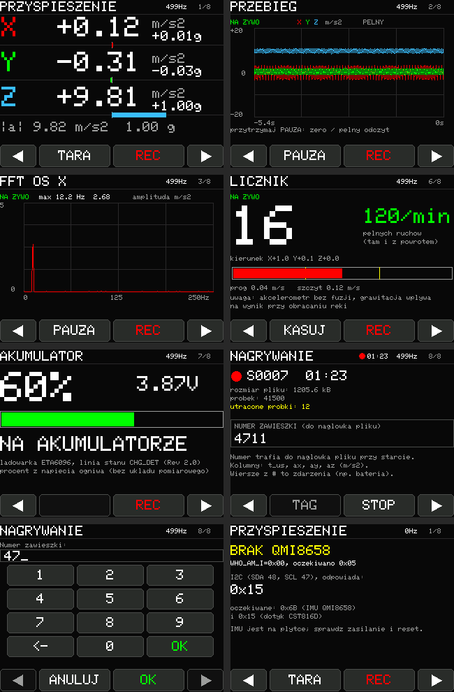

# Przenośny monitor drgań — Waveshare ESP32-S3-Touch-LCD-2

Urządzenie do pomiaru drgań (szyny zawieszek, ramię robota) na płytce
**Waveshare ESP32-S3-Touch-LCD-2** (SKU 29667): przyspieszenie XYZ na żywo,
przebieg, FFT, licznik ruchów, stan akumulatora i **zapis pomiarów na kartę
TF**. Obsługa dotykiem (przeciąganie palcem i przyciski na ekranie) oraz
przyciskiem BOOT. Projekt PlatformIO jest w tym katalogu.

> **Stan:** kod buduje się (`pio run`), a logika niezależna od sprzętu jest
> przetestowana na komputerze. **Nie był jeszcze uruchamiany na płytce** —
> lista rzeczy do sprawdzenia przy pierwszym włączeniu jest niżej.



*Podgląd wyrenderowany na komputerze tym samym kodem rysującym co na
urządzeniu (`tools/render_screens.sh`).*

## Sprzęt

| Element | Układ | Połączenie |
|---|---|---|
| Procesor | ESP32-S3R8 (8 MB PSRAM oktalny, 16 MB flash) | — |
| Wyświetlacz | 2,0" IPS 240×320, ST7789 | SPI: SCLK 39, MOSI 38, DC 42, CS 45, podświetlenie GPIO1 |
| Dotyk | CST816D (pojedynczy punkt) | I2C 0x15 (SDA 48, SCL 47), odpytywany |
| Akcelerometr | QMI8658 (6 osi, używany tylko akcelerometr) | I2C 0x6B, ta sama magistrala |
| Karta TF | gniazdo na płytce, tryb SPI | SCLK 39, MOSI 38, MISO 40 (wspólne z ekranem), CS 41 |
| Akumulator | złącze MX1.25, ładowarka ETA6096 | napięcie: ADC GPIO5 (dzielnik 200 k/100 k, VBAT = 3×); ładowanie: GPIO18 |
| Kamera | złącze 24-pin (OV2640/OV5640) | nieużywana, piny zarezerwowane (niżej) |

Piny pochodzą z tabeli GPIO na schemacie producenta (Rev 1.0 i Rev 2.0) i
zgadzają się z przykładowym kodem producenta. Wszystkie są w jednym pliku:
`src/hal/BoardPins.h`.

**Rev 1.0 / Rev 2.0.** Linia stanu ładowania (`CHG_DET`, GPIO18, wysoki =
ładowanie) istnieje tylko na płytce **Rev 2.0** (nadruk „Rev2.0” na PCB). Na
Rev 1.0 ustaw `kHasChargeDetect = false` w `BoardPins.h`: ekran akumulatora
pokazuje wtedy tylko napięcie i procent.

**Orientacja.** Obraz jest poziomy (320×240, `setRotation(3)` w Adafruit
ST7789 = MADCTL 0x60, jak rotacja 1 w bibliotece producenta), a dotyk jest
przeliczany tak samo jak w przykładzie producenta. Jeśli obraz albo dotyk
okażą się odwrócone, zmień `kLcdRotation` (1 lub 3) i funkcję
`mapTouchLandscape` w `include/TouchGestures.h`.

### Wolne GPIO i kamera

Na złączach wyprowadzone są GPIO 2, 4, 6–21 (poza 19/20 = USB), 47, 48, TX
i RX. Piny kamery z przykładu producenta: XCLK 8, SIOD 21, SIOC 16, PCLK 9,
VSYNC 6, HREF 4, PWDN 17, dane 2, 7, 10, 14, 11, 15, 13, 12. Są więc
zajęte, dopóki kamera jest włożona. GPIO47/48 to magistrala I2C ekranu
dotykowego i IMU; urządzenia zewnętrzne można tam dołączyć równolegle.

## Obsługa

Osiem stron. Przewijanie:
- **przeciągnięcie palcem** w lewo (następna) lub w prawo (poprzednia) na
  obszarze treści,
- **strzałki ◀ ▶** na dolnym pasku,
- **BOOT** (GPIO0): krótkie naciśnięcie = następna strona.

Dolny pasek ma cztery przyciski: `◀`, przycisk strony, `REC/STOP`, `▶`.

| # | Strona | Przycisk strony | Opis |
|---|---|---|---|
| 1 | Przyspieszenie | TARA / TARA OFF | X, Y, Z w m/s² i g, paski od środka (±20 m/s²), moduł \|a\| |
| 2 | Przebieg | PAUZA / WZNÓW | ostatnie 5,4 s, ±20 m/s²; **przytrzymanie PAUZA** = zero / pełny odczyt |
| 3–5 | FFT osi X, Y, Z | PAUZA / WZNÓW | widmo amplitudowe, skala sztywna 0–5 m/s², do połowy częstotliwości próbek |
| 6 | Licznik ruchów | KASUJ | pełne ruchy tam i z powrotem i tempo na minutę |
| 7 | Akumulator | — | procent, napięcie, stan ładowania |
| 8 | Nagrywanie | TAG | stan karty SD, sesja, numer zawieszki |

`REC` / `STOP` jest na każdej stronie. W nagłówku widać `●` i czas nagrania,
gdy trwa zapis. Komunikaty (np. „TARA USTAWIONA”) pokazują się nad paskiem.

### Strona 1 — przyspieszenie

Czujnik w spoczynku mierzy reakcję podłoża: płasko położona płytka daje
Z ≈ +9,81 m/s². Odczyt jest lekko wygładzony (ok. 0,15 s). **TARA**
odejmuje bieżący wektor (np. grawitację przy ustalonym ułożeniu); „TARA”
na ekranie przypomina, że jest włączona. Gdy czujnik nie odpowiada, strona
zamienia się w panel diagnostyczny: powód, lista adresów I2C, które
odpowiedziały (oczekiwane 0x6B i 0x15).

### Strony 2–5 — przebieg i FFT

Przebieg: każdy przedział 40 ms pokazuje min/max i połączenie między
próbkami. FFT: 1024 próbek (ok. 2 s przy 500 Hz), okno Hanna, usunięta
składowa stała, rozdzielczość ok. 0,5 Hz, zakres 0–250 Hz (oś Hz liczona
ze zmierzonego tempa próbek). Hardware'owy filtr czujnika ma pasmo ok. 67 Hz
(13,37% ODR), więc powyżej niego sygnał jest tłumiony — patrz
„Ustawienia pomiaru”.

### Strona 6 — licznik ruchów

Strojony wcześniej na przyspieszeniu liniowym z fuzji czujników (BNO085).
QMI8658 jej nie ma, więc licznik pracuje na zwykłym przyspieszeniu z
grawitacją, którą odfiltrowuje filtr górnoprzepustowy (1 s). **Obracanie
ręki przesuwa grawitację między osiami tak mocno jak sam ruch, więc wynik
jest słabszy niż poprzednio.** Kierunek ruchu jest wyznaczany ze wszystkich
trzech osi. Nie testowano na prawdziwym ruchu.

### Strona 7 — akumulator

Płytka nie ma układu pomiarowego (fuel gauge), więc procent jest
**szacunkiem z napięcia ogniwa** (mediana z 16 odczytów ADC, krzywa typowego
ogniwa Li-ion 3,27–4,20 V). Podczas ładowania napięcie na zaciskach jest
podniesione, więc procent jest wtedy przybliżony (z poprawką −80 mV, znak „~”).
Stany: `LADOWANIE` (CHG_DET wysoki), `NALADOWANY` (ładowarka bezczynna przy
napięciu ≥ 4,15 V), `NA AKUMULATORZE`, `BRAK AKUMULATORA` (< 2,8 V). Płytka nie
ma pomiaru obecności USB, więc „naładowany” i „zasilanie z USB bez
ładowania” nie są rozróżnialne inaczej niż po napięciu.

### Strona 8 — nagrywanie

`REC` zakłada nowy plik na karcie; `STOP` zamyka go. Nagrywanie startuje
tylko, gdy karta jest gotowa i czujnik daje dane. **TAG** (albo dotknięcie
ramki z numerem) otwiera klawiaturę numeryczną: numer zawieszki (do 8 cyfr)
trafia do nagłówka kolejnego pliku i jest zapamiętany w pamięci nieulotnej.
Numer można zmieniać tylko, gdy nic się nie nagrywa. Docelowo ma go podawać
rozpoznawanie numerów kamerą (niżej).

## Zapis na kartę SD

Karta TF w FAT32. Pliki: `/LOGS/S0001.CSV`, `S0002.CSV`, … (numer sesji =
największy istniejący + 1). Format:

```text
# wibrometr log v1
# device: ESP32-S3-Touch-LCD-2, QMI8658
# session: 7
# uptime_ms_at_start: 345678
# sample_rate_hz: 500.0
# range_g: 8
# tag: 4711
# columns: t_us,ax_m_s2,ay_m_s2,az_m_s2
1234567,0.123,-0.456,9.806
1236567,0.119,-0.459,9.810
# battery t_us=11234567 mV=3871 charging=0
```

- `t_us` — czas od startu urządzenia w mikrosekundach (jednolity: zegar
  próbek wygładza opóźnienia odpytywania), przyspieszenie w m/s² w osiach
  czujnika, trzy miejsca po przecinku.
- Wiersze z `#` to nagłówek i zdarzenia (stan akumulatora co 10 s). Czytniki
  CSV pomijają je jako komentarze (np. `pandas.read_csv(..., comment='#')`).
- Płytka nie ma zegara czasu rzeczywistego, więc w pliku jest czas od
  startu, a nie data.
- Zapis idzie w tle: próbki trafiają do kolejki (ok. 2 s zapasu przy 500 Hz),
  zadanie karty zapisuje je blokami po ok. 3,5 kB co najwyżej co 250 ms,
  a `flush` co 2 s ogranicza utratę danych przy odcięciu zasilania. Utracone
  próbki (kolejka pełna, karta za wolna) liczy ekran nagrywania.
- Przybliżony rozmiar: ok. 28 B na próbkę, czyli ok. 14 kB/s (50 MB/h).
- Brak karty, błąd zapisu albo wyjęcie karty: ekran pokazuje stan, a
  ponowne montowanie jest próbowane co 3 s.

Ekran i karta współdzielą magistralę SPI; ekran wysyłany jest w czterech
pasmach, żeby karta mogła pracować między nimi.

## Ustawienia pomiaru

W `src/AppConfig.h`: częstotliwość próbek (`kSampleRateHz`, domyślnie
500 Hz, nie więcej niż 500 — czujnik jest odpytywany co 1 ms), zakres
(`kRange`, domyślnie ±8 g) i tryb filtra (`kLowPassMode`, domyślnie 13,37%
ODR = 67 Hz). **Odpytywanie, a nie przerwanie:** sygnał „dane gotowe” jest w
QMI8658 na INT2, a na płytce wyprowadzone jest tylko INT1 (GPIO3), więc
próbki są wykrywane odczytem rejestru statusu. Żeby opóźnienia
odpytywania nie psuły FFT, znaczniki czasu liczy pętla fazowa
(`include/SampleClock.h`): próbki mają równe odstępy, a brakujące są
zliczane.

## Kamera i rozpoznawanie numerów (plan)

Kamera nie jest jeszcze obsługiwana. Przygotowane: piny są opisane, a numer
zawieszki trafia do nagłówka pliku. Rozpoznawanie cyfr drukowanych da się
zrobić na płytce małą siecią, ale numery malowane lub zabrudzone zwykle
lepiej rozpoznawać poza urządzeniem na zapisanych zdjęciach (zdjęcie
zawieszki zapisane obok pliku CSV tej samej sesji). Wybór ustalimy, gdy
kamera będzie podłączona.

## Budowanie i wgranie

PlatformIO Core albo rozszerzenie do VS Code:

```powershell
pio run
pio run -t upload --upload-port COM6
pio device monitor --port COM6 --baud 115200
```

Środowisko `waveshare` używa płytki ogólnej `esp32-s3-devkitc-1` z
nadpisanymi ustawieniami pamięci: PSRAM oktalny (`qio_opi`), flash 16 MB,
partycje `default_16MB.csv` (aplikacja ok. 6,25 MB). Dla tej płytki nie ma
gotowej definicji PlatformIO. Platforma pioarduino 55.03.36 (Arduino 3.3.6,
IDF 5.5.2); biblioteka: Adafruit ST7735/ST7789 1.11.0 (z Adafruit GFX).
Pozostałe sterowniki (QMI8658, CST816D, ADC, karta SD, bus I2C) są własne lub
z frameworka.

Gdy wgranie się nie udaje: przytrzymaj BOOT, podłącz USB, puść BOOT (tryb
pobierania). Przy pustym flashu port USB może się ciągle restartować — wejście
w tryb pobierania i wgranie programu to naprawia. Pakiety PlatformIO trafiają
do `${sysenv.TEMP}/vibrationSensor-pio-core`, kompilacja do
`${sysenv.TEMP}/vibrationSensor-pio-build` (poza Dyskiem Google i ścieżką z
polskimi znakami).

## Testy

Bez płytki, na komputerze (g++ z C++17):

```text
g++ -std=c++17 -Wall -Wextra -Iinclude test/port_checks.cpp -o port_checks && ./port_checks
g++ -std=c++17 -Iinclude -fsyntax-only test/signal_checks.cpp
```

`port_checks` sprawdza: dekodowanie próbek QMI8658 (kolejność bajtów, znak,
skale, kody ODR), zegar próbek (równomierność przy jitterze 1 ms, dryf 0,2%,
zliczanie braków, zawinięcie licznika), gesty dotyku (tap, przeciągnięcia
w czterech kierunkach, długie przytrzymanie, ignorowanie wolnego
przeciągania i przekątnej, odporność na pojedynczy zgubiony odczyt),
nawigację i przyciski paska, klawiaturę numeru, model akumulatora (krzywa,
stany, mediana) oraz format plików (nazwy sesji, linie CSV, nagłówek).
`signal_checks` sprawdza historię, FFT-owe okno i licznik ruchów.

Podgląd ekranów: `tools/render_screens.sh <Adafruit-GFX> <katalog>` (potrzebny
Python z Pillow).

## Pierwsze włączenie — co sprawdzić

Wszystko poniżej jest **niesprawdzone na sprzęcie**:

1. Port szeregowy: `IMU: QMI8658 ready, 500.0 Hz` i co sekundę `rate=` około
   500. Wartość wyraźnie większa niż 500 oznacza, że flaga „dane gotowe” nie
   czyści się przy odczycie (ostrzeżenie `duplicates?`).
2. Obraz ma właściwe kolory (gdy kolory są odwrócone, to kwestia inwersji
   ST7789) i orientację; dotknięcie lewej krawędzi powinno wywołać reakcję po
   lewej (jeśli jest odwrócone — patrz „Orientacja”).
3. Płasko: Z ≈ +9,8 m/s², X i Y blisko zera; po obróceniu grawitacja
   przechodzi między osiami, a |a| zostaje ok. 9,8 m/s².
4. Przeciągnięcie palcem zmienia strony w obu kierunkach; strzałki i BOOT
   też.
5. Karta SD: strona 8 pokazuje „KARTA GOTOWA”; `REC` → plik w `/LOGS`;
   `STOP` → plik się zamyka; plik otwiera się w arkuszu/Pythonie.
6. Akumulator: napięcie zgadza się z multimetrem; po podłączeniu USB stan
   zmienia się na `LADOWANIE` (Rev 2.0). Jeśli stan ładowania jest odwrotny,
   odwróć interpretację `kHasChargeDetect`/polaryzację w `hal/Battery.cpp`.
7. Przy nagrywaniu 500 Hz sprawdź w liczniku „utracone próbki” przez kilka
   minut (powinno być 0).

## Ograniczenia

- Pomiar jest szacunkiem tanim czujnikiem MEMS: typowo przesunięcie zera
  rzędu ±0,1 m/s² i błąd czułości kilka procent; niczego nie kalibrujemy
  (do usunięcia przesunięcia służy TARA).
- 500 Hz próbek i filtr 67 Hz nie wystarczają do szerokopasmowej diagnostyki
  łożysk; to podgląd drgań, a nie ocena według norm. Gdy potrzebne jest
  więcej pasma, zwiększ `kLowPassMode`/ODR (z odpowiednim odpytywaniem).
- Dotyk jest pojedynczy (bez gestów dwoma palcami).
- Procent akumulatora to oszacowanie z napięcia, bez układu pomiarowego.

## Wcześniejsze wersje

Projekt powstał na Adafruit Feather ESP32-S3 TFT (BNO085, potem MPU6050).
Kod prototypu nawigacji po Wi-Fi (`src/indoor_positioning/`,
`src/NavigationScreen.*`, testy `test/ips_checks.cpp`) został w repozytorium,
ale nie jest budowany dla tej płytki (`build_src_filter` w `platformio.ini`).
Algorytmy (historia, FFT, licznik ruchów) są wspólne i mają testy.
