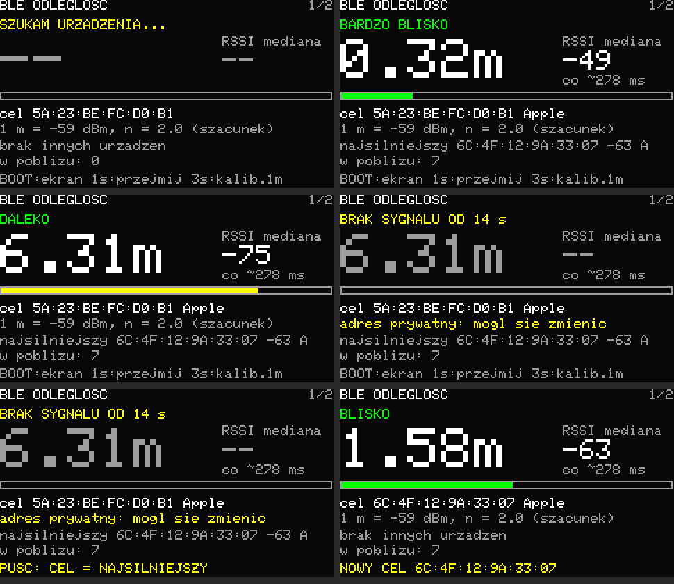
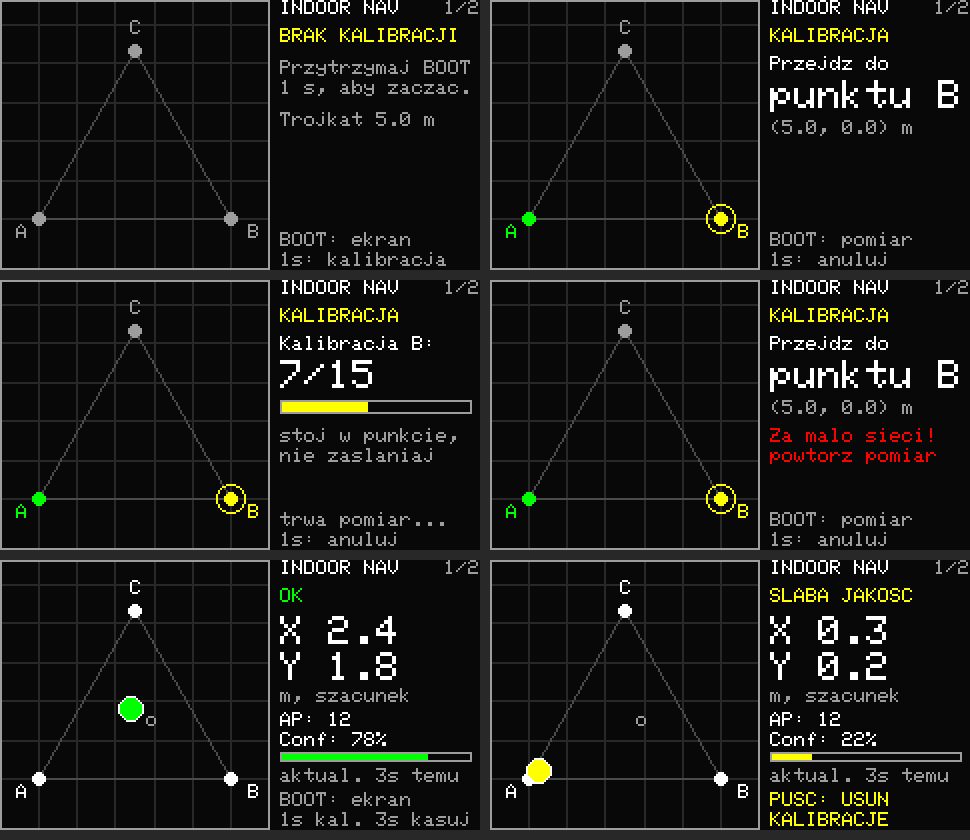

# Przenośny monitor drgań — Feather ESP32-S3 TFT + GY-BNO085

Pierwsza wersja do obserwacji przyspieszeń ramienia robota podczas ruchu.
Projekt PlatformIO znajduje się w tym katalogu. Płytka: Adafruit **5483**
ESP32-S3 TFT Feather, nie wersja Reverse TFT.

> **Stan obecny:** urządzenie mierzy odległość do wybranego urządzenia BLE —
> patrz [Odległość do urządzenia BLE](#odległość-do-urządzenia-ble).
> Ekrany: 1/2 — odległość BLE, 2/2 — akumulator.
> Pozostałe funkcje są wyłączone flagami w `src/main.cpp`, a ich kod jest
> zachowany: akcelerometr i jego ekrany (`imuEnabled`, ekrany 1–5 poniżej)
> oraz nawigacja po Wi-Fi (`ipsEnabled`; w praktyce działała słabo).
> Wyłączony moduł nie trafia do firmware.

## Połączenia

Czujnik pracuje przez SPI (tryb 3, 1 MHz), na wspólnej magistrali z TFT.

| GY-BNO085 | Feather |
|---|---|
| SCL (SCK) | SCK / GPIO36 |
| AD0 / DI (MOSI) | MOSI / GPIO35 |
| SDA (MISO) | MISO / GPIO37 |
| CS | A5 / GPIO8 |
| INT | A4 / GPIO14 |
| RST | A3 / GPIO15 |
| PS0 (WAKE) | A2 / GPIO16 |
| PS1 | 3V |
| GND | GND |
| Zasilanie modułu | 3V / 3,3 V, zgodnie z opisem wejścia Twojego GY-BNO085 |

Linie SPI pracują na poziomie 3,3 V. Sprawdź oznaczenia na swoim wariancie
GY; moduły mogą mieć różne regulatory i opisy pinów (MOSI bywa opisane
jako AD0, SA0 lub DI). INT, RST i PS0 są wymagane. PS0 nie może być
na stałe podpięty do 3V: firmware trzyma go wysoko podczas resetu (tryb
SPI), a przed każdym zapisem ściąga nisko (WAKE), żeby czujnik
zgłosił gotowość przez INT — bez tego czujnik nie przyjmuje poleceń.
Piny można zmienić w stałych `imuInt` / `imuRst` / `imuWake`
w `src/main.cpp`.

Gdy czujnik nie odpowiada, ekran pokazuje `BNO: BRAK INT` (brak reakcji
INT po resecie — sprawdź INT, RST, zasilanie) albo `BNO: BRAK SPI`
(INT działa, ale brak odpowiedzi — sprawdź PS0, PS1, SCK, MOSI, MISO, CS).
Port szeregowy podaje szczegóły każdej próby. Krótki przewód i wspólna masa.

## Ekran i obsługa

Sześć ekranów przełączanych krótkim naciśnięciem BOOT (numer w prawym górnym
rogu): 1 — przebieg czasowy XYZ, 2/3/4 — FFT osi X/Y/Z, 5 — licznik ruchów,
6 — akumulator. Na ekranie 5 BOOT działa inaczej (niżej).

### 1. Przebieg czasowy

- X czerwony, Y zielony, Z niebieski; jednostka m/s².
- Ostatnie 4 s, skala stała ±20 m/s², nowe dane po prawej.
- Odczyt żądany 150 Hz (stała `reportUs` = 6667 µs w `src/main.cpp`);
  zmierzone maksimum tego czujnika w trybie SPI to ok. 180 Hz, więc 150 Hz
  ma zapas. FFT sięga ok. 75 Hz. Ekran docelowo 25 Hz. Nagłówek podaje faktyczną
  liczbę otrzymanych raportów na sekundę, nie zmierzone pasmo czujnika.
- Każdy przedział 40 ms pokazuje min/max oraz połączenie między próbkami.
  To obwiednia pików z odczytów, a nie prezentacja wszystkich punktów.
- POZA SKALA oznacza obcięcie widoku; dane nie są automatycznie skalowane.
- Przerwy w raportach pozostawiają puste przedziały, bez sztucznych zer.
- BRAK BNO085 / RETRY: ponowienie inicjalizacji co około 3 s po błędzie.
- UTRATA PROBEK: przepełnienie kolejki w dowolnym momencie od startu.

### 2–4. FFT osi X, Y, Z

- Widmo amplitudowe z ostatnich 512 próbek (ok. 3,4 s przy 150 Hz),
  okno Hanna, usunięta składowa stała (grawitacja i offset nie wpływają
  na wykres). Rozdzielczość ok. 0,3 Hz, zakres 0 Hz – połowa faktycznej
  częstotliwości raportów (ok. 75 Hz przy 150 Hz). Oś Hz skaluje się
  według zmierzonego tempa raportów, więc przy mniejszej częstotliwości
  pokazuje mniejszy zakres. Czas próbek pochodzi z zegara czujnika
  (znacznik czasu każdego raportu), a nie z chwili odbioru pakietu.
  Czujnik pakuje wiele raportów w jeden pakiet SPI; firmware odbiera
  każdy z nich własną funkcją zwrotną, bo biblioteka Adafruit zachowuje
  tylko ostatni raport z pakietu.
- Oś pionowa: amplituda sinusoidy w m/s² rysowana jako linia, skala sztywna 0–5 (stała
  `fftRange`); większe prążki są obcinane. Wiersz statusu podaje
  częstotliwość i amplitudę największego prążka.
- ZBIERANIE n/512: okno jeszcze się wypełnia (po starcie, wznowieniu
  pauzy lub przerwie w raportach dłuższej niż 100 ms).

### 5. Licznik ruchów

Licznik powtarzalnych ruchów posuwistych ręki trzymającej czujnik. Duża
liczba to **pełne ruchy** (tam i z powrotem), obok tempo w ruchach na minutę.
Dostrojony do 0,7–5 ruchów/s i skoku od kilku do kilkunastu cm.
- Źródłem jest przyspieszenie liniowe z fuzji czujnika (bez grawitacji,
  ok. 100 Hz), bo obrót dłoni przesuwa grawitację między osiami tak samo
  mocno jak sam ruch. Gdy czujnik go nie udostępnia, ekran to pisze na
  żółto i liczy ze zwykłego przyspieszenia (wyraźnie słabiej).
- Kierunek ruchu wyznaczany jest automatycznie ze wszystkich trzech osi
  (dominujący kierunek z ostatnich ok. 0,5 s) i śledzi obrót nadgarstka,
  więc ułożenie czujnika w dłoni nie ma znaczenia. Ekran pokazuje bieżący
  kierunek w osiach czujnika.
- Przyspieszenie jest wygładzane i całkowane do sygnału zbliżonego do
  prędkości: każde przesunięcie daje jeden wyraźny impuls; dwa impulsy
  w przeciwne strony to jeden ruch.
- Próg to 20% ostatniego szczytu (zanik w ok. 1 s, minimum 0,04 m/s), więc
  liczą się zarówno delikatne, jak i mocne ruchy; drżenie dłoni nie liczy się.
- Pasek pokazuje bieżący sygnał względem progu (żółte znaczniki).
- Symulacja (6×30 s na scenariusz): stałe i zmienne tempo 0,7–5 ruchów/s,
  dowolna oś, pauzy: 0% do −2% błędu; przy obrocie nadgarstka 20°/s: −2%.
  Nie testowano na prawdziwym ruchu.
- Licznik działa niezależnie od pauzy na innych ekranach.
- **BOOT na tym ekranie:** krótkie naciśnięcie kasuje licznik, przytrzymanie
  ≥1 s przechodzi do następnego ekranu.

### 6. Akumulator

- Procent naładowania, napięcie ogniwa i pasek stanu z układu pomiaru
  na płytce (I2C, GPIO42/41). Odczyt co 2 s.
- Nowsze płytki 5483 mają MAX17048: stan ładowania wynika ze znaku
  szybkości zmiany naładowania (%/h): LADOWANIE, ROZLADOWANIE,
  NALADOWANY lub BEZ ZMIAN. Ładowarka nie ma wyjścia statusu na GPIO,
  więc to jedyna dostępna informacja; po starcie wartość ustala się
  przez pewien czas.
- Starsze płytki z LC709203F pokazują tylko procent i napięcie — ten
  układ nie odróżnia ładowania od rozładowania.
- BRAK ODCZYTU UKLADU POMIARU: układ nie odpowiada (np. brak akumulatora,
  bo MAX17048 jest zasilany z ogniwa). Ponowna próba co 5 s.

**BOOT (GPIO0), akcja przy puszczeniu:**

| Naciśnięcie | Działanie |
|---|---|
| krócej niż 1 s | następny ekran |
| 1–3 s | pauza / wznowienie wykresu i FFT |
| od 3 s | ustawienie zera (odjęcie ostatniego odczytu XYZ) albo, gdy zero jest ustawione, powrót do pełnego przyspieszenia |

Pauza zatrzymuje tylko widok; odczyt i status działają dalej. Wznowienie
i zmiana offsetu czyszczą historię. Na ekranie pojawia się wskazówka
zależna od czasu przytrzymania. RESET płytki restartuje firmware.
Nie trzymaj BOOT podczas resetu, jeśli nie chcesz uruchomić bootloadera.
Płytka 5483 ma tylko jeden przycisk użytkownika; nie używamy D1/D2.

## Odległość do urządzenia BLE

Szacunek odległości do jednego urządzenia Bluetooth Low Energy na podstawie
siły jego sygnału (RSSI). Domyślny cel: `5A:23:BE:FC:D0:B1` (stała
`BLE_TARGET_ADDRESS` w `src/ble_ranging/BleDistance.h`, można nadpisać
w `platformio.ini`).



*Podgląd wyrenderowany na komputerze tym samym kodem co na urządzeniu (skala 2×).*

**Ważne — adres się zmienia.** `5A:…` to losowy adres prywatny (RPA, dwa
najstarsze bity `01`). Telefony Apple i Android zmieniają go zwykle co ok.
15 minut, więc stary adres w pewnym momencie przestanie być widoczny. Ekran
podpowiada to na żółto, gdy cel z takim adresem zniknie na dłużej niż 10 s.
Wtedy połóż urządzenie blisko płytki i przytrzymaj BOOT 1 s — najsilniejsze
słyszane urządzenie (poza obecnym celem) zostaje nowym celem i jest
zapamiętywane w NVS. Na ekranie widać jego adres i RSSI, a „A”/„Apple”
oznacza dane producenta Apple w rozgłoszeniu.

| BOOT | Działanie |
|---|---|
| krótko | następny ekran |
| ≥1 s | nowy cel = najsilniejsze inne urządzenie z ostatnich 3 s |
| ≥3 s | kalibracja 1 m: trzymaj cel 1 m od płytki; bieżąca mediana RSSI staje się wartością odniesienia |

Cel i kalibracja zapisują się w NVS i przetrwają restart.

**Jak liczona jest odległość:**
- skanowanie pasywne, ciągłe (okno = interwał 50 ms), każde rozgłoszenie to
  próbka RSSI;
- poziom sygnału = mediana próbek z ostatnich 3 s (odporna na pojedyncze
  odbicia i zaniki);
- odległość `d = 10^((P1m − RSSI) / (10·n))`, gdzie P1m = RSSI na 1 m
  (domyślnie −59 dBm, jak w popularnych aplikacjach-skanerach — ten sam
  model daje 0,28 m dla −48 dBm ze zrzutu), n = 2;
- ekran podaje też typowy odstęp rozgłoszeń, liczbę urządzeń w pobliżu
  i najsilniejsze inne urządzenie.

**Dokładność — to szacunek.** Ciało, ściany, ułożenie anten i odbicia
zmieniają RSSI o 5–10 dB, czyli przy n = 2 odległość nawet 2–3×.
W symulacji (szum 4 dB i 10% głębokich zaników) 95% odczytów mieściło się
w ×1,8 prawdziwej odległości, a typowy w ×1,3; seria zaników w jednym oknie
potrafi chwilowo pokazać 2–4× za daleko. Kalibracja 1 m z konkretnym
urządzeniem wyraźnie poprawia wynik; wykładnik n (`kPathLossExponent`)
w pomieszczeniach bywa 2–3.

**Implementacja:** `src/ble_ranging/` — `BleRanging` (czysty C++: adres,
filtr RSSI, model, śledzenie celu i kandydatów; testy w
`test/ble_checks.cpp`), `BleScanner` (NimBLE z ESP-IDF bezpośrednio, bez
biblioteki Arduino BLE — tak jak przy Wi-Fi nie dokłada źródeł
problematycznych przy skracaniu ścieżek na Windowsie), `BleDistance`
(zapis w NVS, log na Serial co 1 s). Ekran: `src/BleScreen`. Odświeżanie
4 razy na sekundę.

Testy na komputerze:

```text
g++ -std=c++17 -Isrc/ble_ranging test/ble_checks.cpp src/ble_ranging/BleRanging.cpp -o ble_checks && ./ble_checks
```

Sprawdzenie na urządzeniu: monitor portu pokazuje co sekundę
`BLE: rssi=… median=… distance~… interval~…`. Porównaj z aplikacją na
telefonie przy 0,3 m, 1 m i 3 m; zrób kalibrację 1 m i powtórz pomiary.

## Nawigacja wewnętrzna (Wi-Fi RSSI) — prototyp

> Wyłączona (`ipsEnabled = false` w `src/main.cpp`): w praktyce działała
> słabo. Opis poniżej dotyczy kodu, który pozostał w repozytorium.

Eksperyment: szacowanie położenia w pomieszczeniu na podstawie siły
sygnałów okolicznych punktów dostępowych Wi-Fi (fingerprinting RSSI).
Działa autonomicznie — bez Internetu, serwera i bez łączenia się z siecią;
ESP32 jedynie skanuje eter. **Pozycja jest szacunkiem z interpolacji trzech
punktów odniesienia, a nie pomiarem w metrach.** Przy trzech punktach
spodziewaj się błędów rzędu metrów; to demonstrator, który pozwala ocenić,
na ile fingerprinting działa w danym miejscu.



*Podgląd wyrenderowany na komputerze tym samym kodem i biblioteką GFX co
na urządzeniu (skala 2×).*

### Obsługa (ekran mapy)

| Stan | BOOT krótko | BOOT ≥1 s | BOOT ≥3 s |
|---|---|---|---|
| mapa (zwykły widok) | następny ekran | rozpocznij kalibrację | usuń kalibrację z pamięci |
| kalibracja — czekanie na punkt | zmierz punkt | anuluj (stara kalibracja zostaje) | — |
| kalibracja — pomiar | — | anuluj | — |

Kalibracja zapisuje się w pamięci nieulotnej (NVS) i przetrwa restart.
Nowa kalibracja zastępuje starą dopiero po pomiarze wszystkich trzech punktów.

### Kalibracja — trzy punkty

Trójkąt równoboczny o boku `CALIBRATION_SIDE_M` (domyślnie 5 m):
A (0, 0), B (5, 0), C (2,5, 4,33) — współrzędne liczone z długości boku.

1. Przytrzymaj BOOT 1 s na ekranie mapy → „Przejdź do punktu A”
   (punkt docelowy miga na mapie).
2. Stań w punkcie A, naciśnij BOOT. Urządzenie wykonuje 15 skanów
   (ok. 25 s, zależnie od czasu skanu) — ekran pokazuje np. „Kalibracja A: 7/15”. Stój w miejscu
   i nie zasłaniaj urządzenia.
3. To samo w B i C. Po C kalibracja zapisuje się i od razu włącza się
   lokalizacja.

Jeśli w punkcie zostanie mniej niż 3 użyteczne sieci, ekran pokaże „Za mało
sieci” — pomiar tego punktu można powtórzyć tym samym przyciskiem.

Agregacja punktu (dla każdego BSSID osobno; SSID i kanał są zapisywane
pomocniczo, bo SSID nie jest unikalny):
- odrzucenie wartości odstających: dalej niż max(6 dB, 3·1,4826·MAD)
  od mediany;
- zapis średniej, odchylenia, liczby wykryć i liczby skanów;
- pominięcie AP widocznych w mniej niż 50% skanów, słabszych niż
  −90 dBm albo z odchyleniem > 8 dB;
- najwyżej 24 najsilniejsze AP na punkt.

### Algorytm lokalizacji

Co ok. 2,5 s (skan aktywny 120 ms na kanał, ok. 1,6 s; w tle — interfejs
działa dalej):
1. Bieżący wektor RSSI po BSSID porównywany jest z każdym punktem jako
   ważony RMS różnic w dB (bez modelu tłumienia; RSSI nie jest liniowe
   względem odległości):
   - waga AP = wykrywalność / (σ² + 2²) — stabilne AP ważą więcej;
   - AP nieobecny w profilu punktu liczy się jako −100 dBm (brak też
     niesie informację);
   - AP niewidoczny w bieżącym skanie ma połowę wagi i liczy się tylko
     różnica między punktami (może to być chwilowy zanik albo wyłączony AP);
   - każda różnica jest obcięta do 12 dB, a najgorzej pasujący AP
     odrzucony — pojedynczy niestabilny AP nie przeważy wyniku;
   - nowe, nieznane BSSID są pomijane.
2. Wagi punktów `1 / (d + 1 dB)³`, pozycja = średnia ważona A, B, C.
   W tej wersji wynik leży zawsze w trójkącie.
3. Mniej niż 3 rozpoznane AP → `NO_POSITION`.
4. Confidence 0–100% to heurystyka (nie gwarancja dokładności): jakość
   najlepszego dopasowania × pokrycie znanych AP × rozróżnialność punktów
   × liczba AP. Poniżej 40% → `LOW_CONFIDENCE`.

Filtr pozycji: EMA (α = 0,35, mniejsza przy niskim confidence); skok
> 2 m wymaga potwierdzenia drugim pomiarem w tym samym miejscu (rzeczywisty
ruch pokaże się o jeden pomiar później, pojedynczy zły skan — wcale);
strefa martwa 0,15 m. Bieżąca pozycja nie jest zapisywana do flash.

Na mapie: zielona/żółta kropka — pozycja po filtrze, mały okrąg — ostatni
surowy wynik.

### Konfiguracja i diagnostyka

Parametry w `src/indoor_positioning/IpsConfig.h`; najważniejsze można
nadpisać w `platformio.ini` (`build_flags`, przykłady zakomentowane):
`CALIBRATION_SIDE_M`, `IPS_SCANS_PER_POINT`, `IPS_DEBUG`.

`-D IPS_DEBUG=1` wypisuje na Serial: listę BSSID/RSSI z każdego skanu,
zapisane fingerprinty A/B/C, odległości od nich, wagi interpolacji,
pozycję przed i po filtrze, confidence, czas skanu i czas obliczeń.

### Architektura

`src/indoor_positioning/`:
- `WifiFingerprint` — typy danych i agregacja kalibracji (czysty C++),
- `FingerprintLocator` — dopasowanie i interpolacja (czysty C++, dowolna
  liczba punktów ≥ 2 — gotowe na więcej punktów kalibracyjnych),
- `PositionFilter` — wygładzanie (czysty C++),
- `WifiScanner` — nieblokujące skanowanie bezpośrednio przez ESP-IDF
  (`esp_wifi`); biblioteka Arduino `WiFi` jest celowo pominięta, bo ciągnie
  źródła `Network`/lwIP, które na Windowsie nie kompilują się po skróceniu
  ścieżek include przez pioarduino (`lwip/sockets.h: No such file`),
- `FingerprintStore` — zapis w NVS (Preferences),
- `IndoorPositioning` — maszyna stanów i API: `startCalibration()`,
  `confirmCalibrationPoint()`, `cancelCalibration()`, `isCalibrated()`,
  `startPositioning()`, `stopPositioning()`, `getPosition()`,
  `getCalibrationProgress()`, `resetCalibration()`.

`src/NavigationScreen` rysuje ekran ze stanu (bez dostępu do radia).
Wszystkie bufory mają stały rozmiar (bez alokacji na skan). Po dodaniu
Wi-Fi firmware zajmuje 61% flash (+0,5 MB) i 27% statycznego RAM (+45 KB);
sterownik Wi-Fi rezerwuje dodatkowo pamięć dynamiczną w czasie działania.

### Testy na komputerze

```text
g++ -std=c++17 -Isrc/indoor_positioning test/ips_checks.cpp src/indoor_positioning/WifiFingerprint.cpp src/indoor_positioning/FingerprintLocator.cpp src/indoor_positioning/PositionFilter.cpp -o ips_checks && ./ips_checks
```

Syntetyczne pomieszczenie (AP, tłumienie, szum, zaniki) sprawdza:
agregację i odrzucanie wartości odstających, pozycję w A/B/C i pomiędzy,
brak części AP, nowe nieznane AP, duże wahania RSSI (8 dB), pojedynczy
szalejący AP, brak danych, nierozróżnialne punkty, dzielenie przez zero
i stabilność nieruchomego punktu z filtrem. Wynik nieruchomego punktu
w środku trójkąta (najbardziej niejednoznaczne miejsce) waha się
w symulacji w zakresie ok. ±0,65 m przy 2 dB szumu.

### Sprawdzenie na urządzeniu

1. Wgraj firmware (najlepiej z `-D IPS_DEBUG=1`) i otwórz monitor portu.
2. Odmierz trójkąt o boku 5 m (lub ustaw `CALIBRATION_SIDE_M`), zaznacz
   punkty. Pomieszczenie powinno „widzieć” co najmniej kilka sieci.
3. Wykonaj kalibrację A → B → C; po każdym punkcie Serial podaje liczbę
   użytecznych AP. Zrestartuj płytkę i sprawdź, czy kalibracja wczytuje się
   z NVS („IPS: calibration loaded from NVS”).
4. Stań kolejno w A, B, C i w środku boków; zanotuj pozycję po ustaleniu
   (kilka aktualizacji) i confidence. Postój 1–2 min w jednym miejscu
   pokaże rozrzut pozycji.
5. Przejdź z A do B: kropka powinna podążać z opóźnieniem 1–2 aktualizacji.
6. Sprawdź „BOOT ≥3 s” (usunięcie kalibracji) i anulowanie kalibracji.

Ograniczenia: trzy punkty dają tylko interpolację wewnątrz trójkąta;
ludzie, drzwi i zmiana położenia AP zmieniają odczyty (kalibrację trzeba
wtedy powtórzyć); telefony i hotspoty mogą się pojawiać i znikać; orientacja
urządzenia i ciało użytkownika tłumią sygnał o kilka dB.

## Budowanie i wgranie

PlatformIO Core lub rozszerzenie PlatformIO w VS Code:

```powershell
pio run
pio run -t upload --upload-port COM6
pio device monitor --port COM6 --baud 115200
```

COM6 to port wykryty podczas tworzenia projektu; może zmienić się po
resecie lub na innym komputerze. Sprawdzenie: `pio device list`.
Po wgraniu monitor powinien podawać połączenie z IMU, częstotliwość raportów
i liczbę utraconych próbek. Jeżeli automatyczny upload nie działa:
przytrzymaj BOOT, naciśnij RESET, puść BOOT, sprawdź port i ponów upload.

Platforma jest przypięta do pioarduino 55.03.36 (Arduino 3.3.6, IDF 5.5.2).
Biblioteki: Adafruit BNO08x 1.2.5, ST7735/ST7789 1.11.0 i LC709203F 1.3.4.
Pakiety PlatformIO trafiają do ${sysenv.TEMP}/vibrationSensor-pio-core;
pliki kompilacji do ${sysenv.TEMP}/vibrationSensor-pio-build.
Oba katalogi znajdują się poza Dyskiem Google i ścieżką zawierającą polskie
znaki (linker nie obsługuje jej poprawnie). Pierwsza instalacja
pobiera kompilator i framework. Nie dodawać .pio do git.

## Testy i sprawdzenie na sprzęcie

Testy `test/signal_checks.cpp` wykonują rzeczywistą logikę jako
C++17 constexpr/static_assert: min/max, przerwy, kolejność po zawinięciu
bufora, offset, czyszczenie i rollover czasu. Można je sprawdzić bez
podłączonej płytki dowolnym kompilatorem C++17:

```text
g++ -std=c++17 -Iinclude -fsyntax-only test/signal_checks.cpp
```

1. Po starcie potwierdź odczyt ok. 150 Hz (nagłówek ekranu i `rate=` na porcie szeregowym) i poprawny wykres na TFT.
2. Obracaj czujnik w spoczynku: składowa grawitacji powinna przechodzić
   między osiami. Pełne przyspieszenie statyczne ma moduł około 9,81 m/s².
3. Sprawdź przełączanie ekranów, pauzę, zero i kasowanie offsetu; lekkie stuknięcie powinno
   być widoczne jako pik. Sprawdź też zachowanie poza skalą.
4. Po wyłączeniu zasilania zmień połączenia i sprawdź start bez czujnika,
   a następnie ponowny start z czujnikiem. Test zaniku podczas pracy
   wykonaj przez przełącznik testowy/odpowiednie złącze, bez zwierania pinów.
5. Sprawdź raporty przez kilka minut w docelowym montażu i na przewodzie
   docelowej długości. Oczekuj drops=0; zanotuj spadki częstotliwości.

## Interpretacja i ograniczenia

Raport SH2_ACCELEROMETER zawiera grawitację i przyspieszenia ruchu robota.
Ustawienie zera odejmuje stały wektor, a nie zmienną grawitację podczas
obrotu ramienia ani przyspieszenia trajektorii. Magnes mocujący może
zaburzać magnetometr; ta wersja nie korzysta z orientacji magnetycznej.

150 Hz daje częstotliwość Nyquista 75 Hz; użyteczne pasmo zależy
dodatkowo od filtrów wewnątrz czujnika i jego faktycznego tempa raportów
(sprawdź `rate=` na porcie szeregowym). Ten tryb nie
wystarcza do szerokopasmowej diagnostyki łożysk. FFT to podgląd do połowy
częstotliwości raportów liczony z czasów odbioru raportów; nie ma klasyfikacji usterek,
zapisu ani oceny według norm przemysłowych. Sztywność mocowania
magnetycznego i przewód również wpływają na wynik.

SPI omija znane problemy BNO08x z clock stretching I2C na ESP32-S3.
Każda próba połączenia resetuje czujnik przez RST; nie gwarantuje to
odzyskania ze wszystkich stanów i czasem konieczne jest odłączenie
zasilania samego modułu. Odczyt pracuje w osobnym zadaniu, aby
inicjalizacja IMU nie zatrzymywała TFT; transakcje SPI czujnika i ekranu
są szeregowane przez sterownik magistrali.

Dokumentacja:
- [Feather: piny, zasilanie, TFT i przyciski](https://learn.adafruit.com/adafruit-esp32-s3-tft-feather/pinouts)
- [BNO085: połączenie SPI](https://learn.adafruit.com/adafruit-9-dof-orientation-imu-fusion-breakout-bno085/arduino)
- [Platforma 55.03.36](https://github.com/pioarduino/platform-espressif32/releases/tag/55.03.36)

